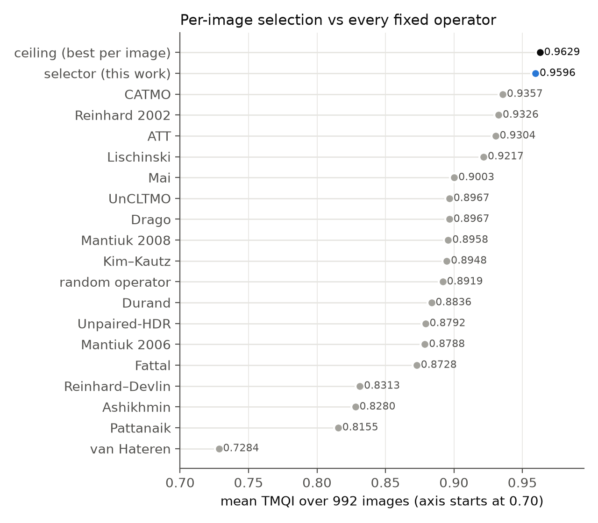
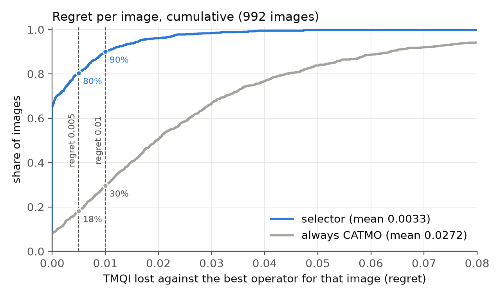
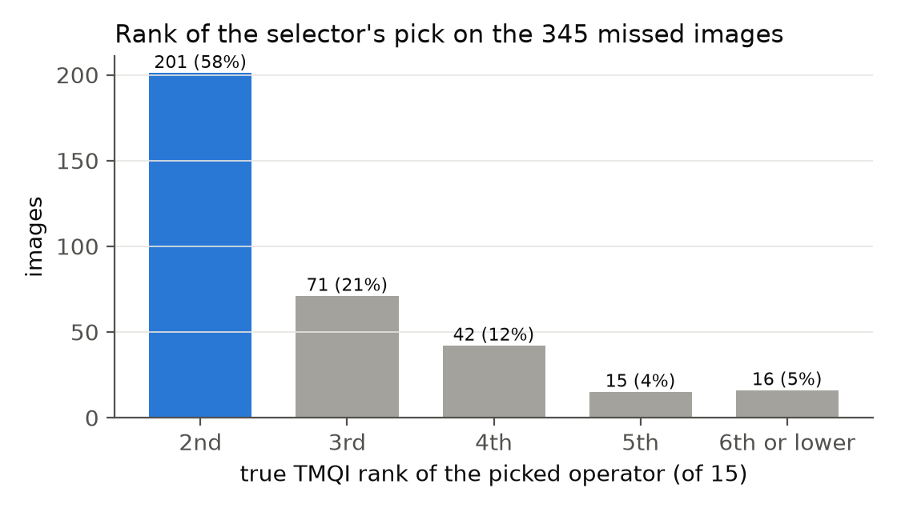
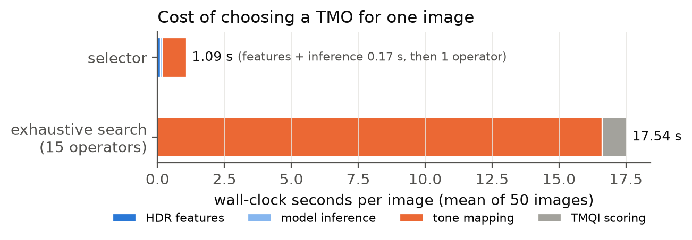
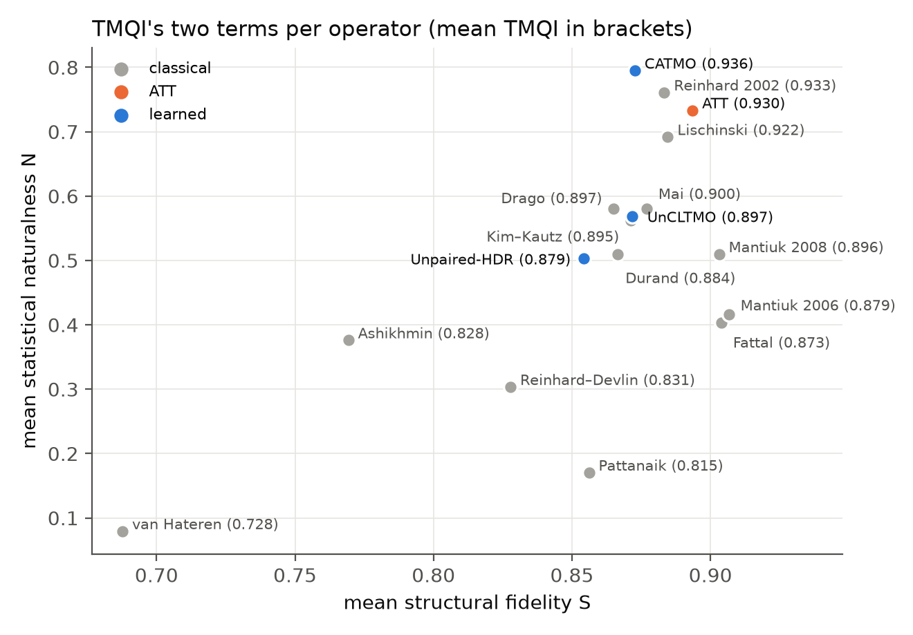
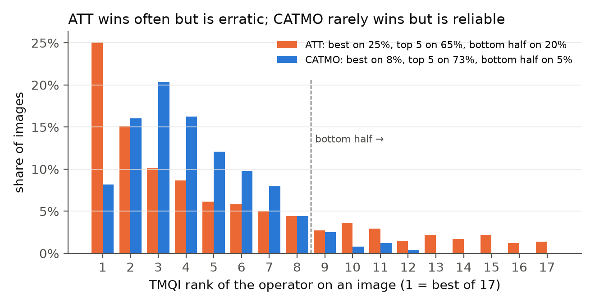

# Tables and figures

*Generated by `report/make_figures.py` from the checked-in results; do not edit by hand. TMQI numbers are out-of-fold, seed 1234, over 992 images, unless stated otherwise.*

**Table 1.** The 17 tone-mapping operators, run with their default parameters.

| operator | reference | type | implementation |
|---|---|---|---|
| Reinhard 2002† | Reinhard et al. 2002 | classical | luminance-hdr |
| Reinhard–Devlin† | Reinhard & Devlin 2005 | classical | luminance-hdr |
| Drago† | Drago et al. 2003 | classical | luminance-hdr |
| Durand | Durand & Dorsey 2002 | classical | luminance-hdr |
| Fattal† | Fattal et al. 2002 | classical | luminance-hdr |
| Mantiuk 2006 | Mantiuk et al. 2006 | classical | luminance-hdr |
| Mantiuk 2008 | Mantiuk et al. 2008 | classical | luminance-hdr |
| Pattanaik†* | Pattanaik et al. 2000 | classical | luminance-hdr |
| Ashikhmin† | Ashikhmin 2002 | classical | luminance-hdr |
| Mai | Mai et al. 2011 | classical | luminance-hdr |
| Lischinski† | Lischinski et al. 2006 | classical | luminance-hdr |
| van Hateren* | van Hateren 2006 | classical | luminance-hdr |
| Kim–Kautz† | Kim & Kautz 2008 | classical | luminance-hdr |
| ATT | Khan et al. 2018 | ATT | Python port of the authors' MATLAB code |
| CATMO | Li et al. 2024 | learned | published weights |
| UnCLTMO | Cao et al. 2024 | learned | published weights |
| Unpaired-HDR | Vinker et al. 2021 | learned | published weights |

luminance-hdr = luminance-hdr-cli 2.6.1.1 in Docker. † writes linear luminance; display-encoded with gamma 2.2. \* never the best operator on any image under TMQI, so not one of the 15 candidates.

**Table 2.** The 151 selector features in 14 groups, each following one published source. All are computed from the HDR input alone.

| category | source | features | what it measures |
|---|---|---|---|
| HDR image statistics | Pouli et al. 2010 | 27 | log-luminance moments, power-spectrum slope, gradient and Laplacian-band statistics, Lαβ colour |
| HDR image statistics | Hulusic et al. 2017 | 5 | perceived dynamic range, image key, bright area, PU21 contrast, colourfulness |
| operator set-up statistics | Reinhard et al. 2002; Reinhard 2002 | 5 | log-average luminance, default white point, automatic key and white-point estimates |
| operator set-up statistics | Drago et al. 2003 | 2 | max / log-average ratio, log-base divider |
| operator set-up statistics | Durand & Dorsey 2002 | 4 | bilateral base-layer range, compression factor, detail energy |
| operator set-up statistics | Fattal et al. 2002 | 6 | average gradient and attenuation at the attenuated pyramid levels |
| operator set-up statistics | Reinhard & Devlin 2005 | 2 | image key k, contrast m |
| operator set-up statistics | Kim & Kautz 2008 | 2 | log-mean, global compression k1 |
| operator set-up statistics | Mai et al. 2011 | 2 | log-histogram normaliser Σp^(1/3), largest tone-curve slope share |
| operator set-up statistics | Mantiuk et al. 2008 | 12 | band-contrast distribution per pyramid level, conditional on background |
| quality-model statistics | Yeganeh & Wang 2013 | 10 | TMQI's HDR-side local-σ visibility at its 5 scales |
| quality-model statistics | Mittal et al. 2012 (Kundu et al. 2017) | 36 | BRISQUE natural-scene statistics of log luminance, 2 scales |
| quality-model statistics | ITU-T P.910 | 1 | spatial information of log luminance |
| quality-model statistics | Yeganeh & Wang 2013 (adapted) | 37 | 11 / 22 / 44-px block statistics of log luminance |
| **total** | | **151** | |

Operator set-up statistics are the quantities each operator computes from its input before mapping, following the luminance-hdr code with its defaults; the operator itself is never run.

**Table 3.** Mean TMQI of the chosen operator over 992 images. Gap recovered = (method − always CATMO) / (ceiling − always CATMO).

| method | mean TMQI | gap recovered | exact accuracy | within 0.005 of best |
|---|---|---|---|---|
| random operator (expected) | 0.8919 | −161% | 6.7% | 10.7% |
| always CATMO (best fixed operator) | 0.9357 | 0% | 8.2% | 18.1% |
| selector, Pouli et al. 2010 features only (27) | 0.9547 | 70% | 50.7% | 64.9% |
| earlier random-forest classifier (21 hand-made features) | 0.9554 | 73% | 52.2% | 67.6% |
| **final selector (151 features, structured LightGBM)** | **0.9596** | **88%** | **65.2%** | **80.4%** |
| ceiling (best operator per image) | 0.9629 | 100% | 100% | 100% |

**Table 4.** Mean TMQI by image source.

| source | images | always CATMO | selector | ceiling | gap recovered | exact accuracy |
|---|---|---|---|---|---|---|
| HDR-Real | 626 | 0.9303 | 0.9548 | 0.9580 | 88% | 64.4% |
| HDR-Synth | 366 | 0.9449 | 0.9677 | 0.9711 | 87% | 66.7% |
| **all** | 992 | 0.9357 | 0.9596 | 0.9629 | 88% | 65.2% |

**Table 5.** Wall-clock seconds per image: mean over 50 images (median in brackets).

| step | selector | exhaustive search |
|---|---|---|
| HDR features (151) | 0.12 (0.13) | — |
| model inference (15 × 3 × 5 = 225 LightGBM models) | 0.05 (0.05) | — |
| tone mapping | 0.92 (0.35), 1 operator | 16.6 (16.6), 15 operators |
| TMQI scoring | — | 0.92 (0.95), 15 outputs |
| **total** | **1.09 (0.52)** | **17.5 (17.5)** |
| selector total, classical or ATT pick (40 images) | 0.48 (range 0.16–1.46) | |
| selector total, learned-operator pick (10 images) | 3.52 (range 2.73–4.47) | |

Speed-up: 16× (ratio of mean times); 34× on the median image. Times include each operator's process start-up, as the benchmark runs them. Apple M3 Pro, one image at a time.

**Table 6.** The same method trained and scored under each metric. The floor is the best fixed operator under that metric.

| metric | best fixed operator | selector | ceiling | gap recovered | exact accuracy |
|---|---|---|---|---|---|
| TMQI (reference) | 0.9357 (CATMO) | 0.9596 | 0.9629 | 88% | 65.2% |
| FSITM–TMQI average | 0.9196 (Reinhard 2002) | 0.9309 | 0.9328 | 86% | 67.7% |
| TMQI-II | 0.8951 (Reinhard 2002) | 0.9142 | 0.9281 | 58% | 61.1% |

**Figure 1.** Mean TMQI over 992 images of every fixed operator, a random operator, the selector and the ceiling (best operator per image).

**Figure 2.** Cumulative distribution of regret (TMQI lost against the best operator for each image), selector vs always CATMO. Dots mark the share of images within 0.005 and 0.01 of the best.

**Figure 3.** True TMQI rank of the operator the selector picked, on the 345 images where it did not pick the best one.

**Figure 4.** Wall-clock time per image, by step: selector vs exhaustive search over the 15 candidate operators.

---

# Benchmark section

*17 operators × 992 images, each output scored against the original HDR. Insert before the selector results; the B labels are placeholders until the final numbering.*

**Table B1.** Every operator under TMQI over 992 images, sorted by mean TMQI. S = structural fidelity, N = statistical naturalness (TMQI's two terms). Rank is among all 17 operators on each image. Time = mean seconds per image over the 50 timed images, including process start-up.

| operator | type | mean TMQI | S | N | best on | top 5 on | bottom half on | mean rank | time (s) |
|---|---|---|---|---|---|---|---|---|---|
| CATMO | learned | 0.9357 | 0.873 | 0.795 | 81 (8%) | 73% | 5% | 4.3 | 2.67 |
| Reinhard 2002 | classical | 0.9326 | 0.883 | 0.761 | 195 (20%) | 66% | 10% | 4.4 | 0.35 |
| ATT | ATT | 0.9304 | 0.894 | 0.733 | 249 (25%) | 65% | 20% | 5.0 | 0.05 |
| Lischinski | classical | 0.9217 | 0.885 | 0.692 | 67 (7%) | 52% | 14% | 5.5 | 0.40 |
| Mai | classical | 0.9003 | 0.877 | 0.581 | 55 (6%) | 33% | 46% | 7.8 | 0.34 |
| UnCLTMO | learned | 0.8967 | 0.872 | 0.568 | 43 (4%) | 27% | 44% | 8.0 | 4.86 |
| Drago | classical | 0.8967 | 0.865 | 0.580 | 48 (5%) | 27% | 52% | 8.4 | 0.39 |
| Mantiuk 2008 | classical | 0.8958 | 0.903 | 0.510 | 39 (4%) | 27% | 57% | 8.3 | 0.38 |
| Kim–Kautz | classical | 0.8948 | 0.871 | 0.562 | 29 (3%) | 29% | 46% | 8.0 | 0.37 |
| Durand | classical | 0.8836 | 0.867 | 0.510 | 24 (2%) | 21% | 55% | 9.0 | 0.40 |
| Unpaired-HDR | learned | 0.8792 | 0.854 | 0.503 | 34 (3%) | 17% | 66% | 9.9 | 3.90 |
| Mantiuk 2006 | classical | 0.8788 | 0.907 | 0.416 | 47 (5%) | 22% | 66% | 9.6 | 0.52 |
| Fattal | classical | 0.8728 | 0.904 | 0.403 | 36 (4%) | 23% | 58% | 9.6 | 1.18 |
| Reinhard–Devlin | classical | 0.8313 | 0.828 | 0.304 | 37 (4%) | 9% | 84% | 12.4 | 0.36 |
| Ashikhmin | classical | 0.8280 | 0.769 | 0.376 | 8 (1%) | 9% | 83% | 12.5 | 0.45 |
| Pattanaik | classical | 0.8155 | 0.856 | 0.171 | 0 (0%) | 1% | 97% | 14.0 | not timed |
| van Hateren | classical | 0.7284 | 0.688 | 0.080 | 0 (0%) | 1% | 98% | 16.2 | not timed |

Bottom half = ranked 9th–17th of 17. Pattanaik and van Hateren were not timed because they are not candidates.

**Table B2.** The answer depends on the metric. Agreement columns compare each image's best operator and full operator ranking with TMQI's.

| metric | best fixed operator (mean) | most frequent winner | ceiling | same best operator as TMQI | median Kendall τ with TMQI |
|---|---|---|---|---|---|
| TMQI | CATMO (0.9357) | ATT (25%) | 0.9629 | — | — |
| FSITM–TMQI average | Reinhard 2002 (0.9196) | Reinhard 2002 (21%) | 0.9328 | 55% | 0.79 |
| TMQI-II | Reinhard 2002 (0.8951) | Reinhard 2002 (30%) | 0.9281 | 11% | 0.54 |
| FSITM | Drago (0.9139) | Drago (46%) | 0.9184 | 6% | 0.28 |

**Table B3.** The five best operators on average, by image source: mean TMQI and number of images won.

| operator | HDR-Real mean | HDR-Real wins | HDR-Synth mean | HDR-Synth wins |
|---|---|---|---|---|
| CATMO | 0.9303 | 44 of 626 | 0.9449 | 37 of 366 |
| Reinhard 2002 | 0.9261 | 105 of 626 | 0.9438 | 90 of 366 |
| ATT | 0.9306 | 184 of 626 | 0.9302 | 65 of 366 |
| Lischinski | 0.9173 | 47 of 626 | 0.9293 | 20 of 366 |
| Mai | 0.8951 | 40 of 626 | 0.9091 | 15 of 366 |

**Figure B1.** Mean structural fidelity S against mean naturalness N for each operator. The operators with the highest S rank low on TMQI because their naturalness is poor.

**Figure B2.** How often ATT and CATMO take each TMQI rank among the 17 operators.

